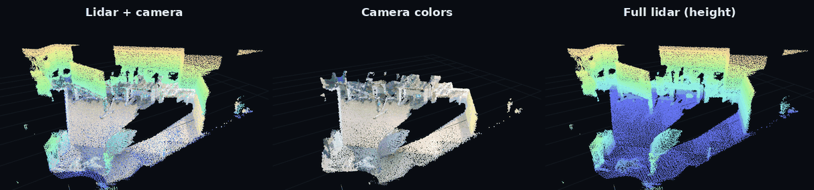
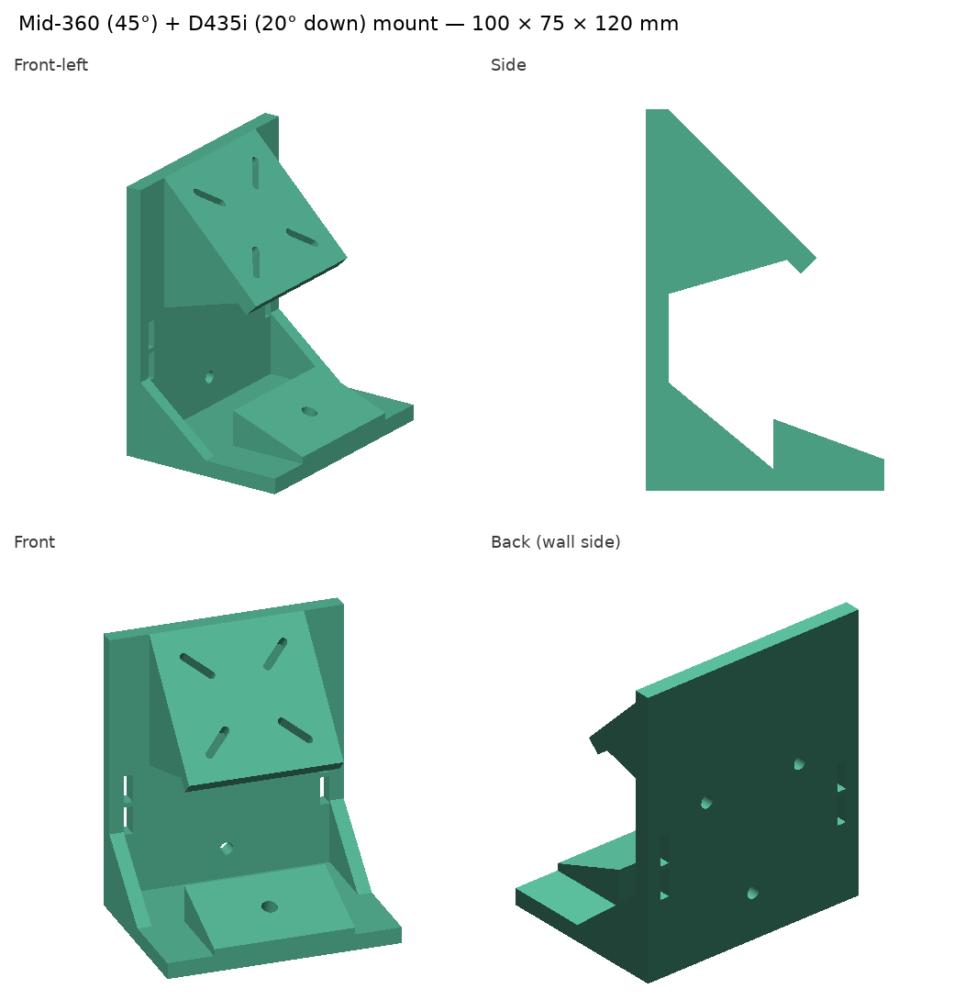
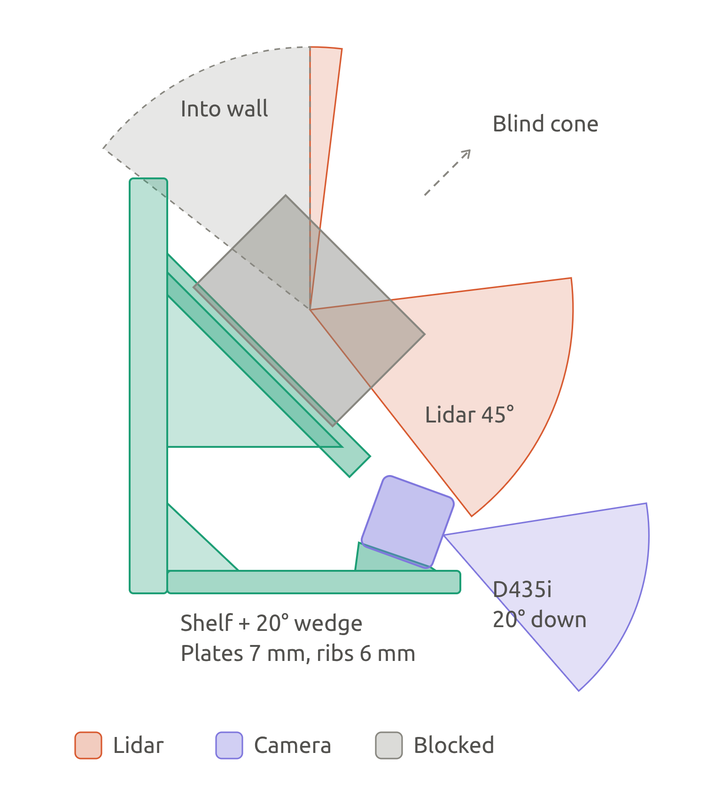
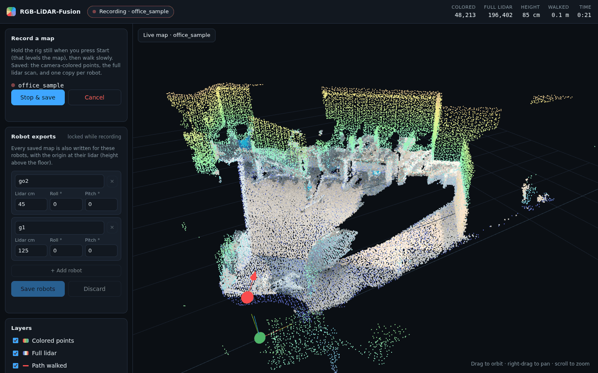
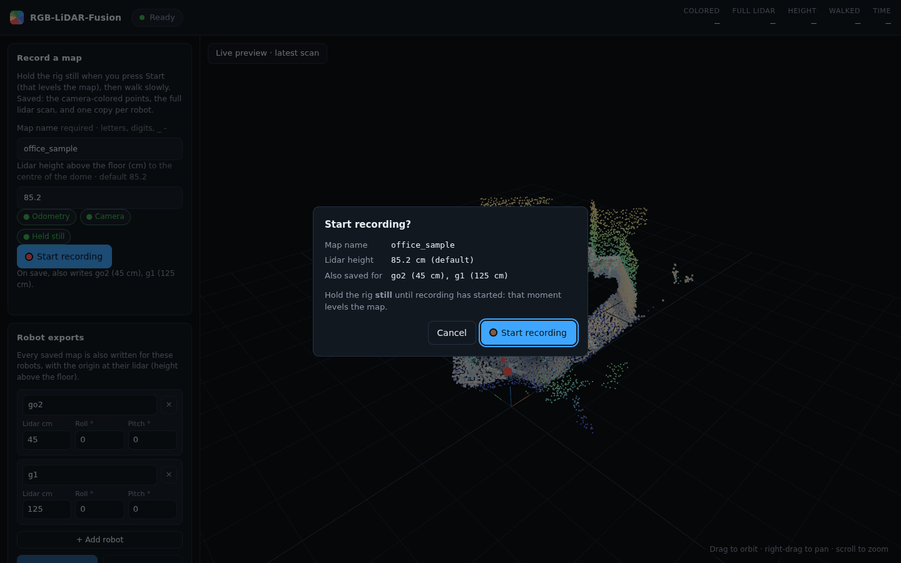
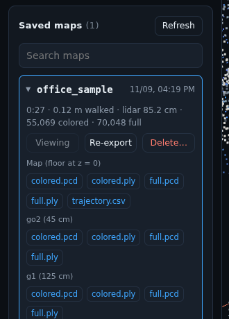

# RGB-LiDAR-Fusion

Real-time RGB camera and Livox Mid-360 LiDAR fusion for generating colorized 3D point clouds. Supports ROS/ROS2 and provides a foundation for 3D perception, mapping, and robotics applications.

> **Status:** early development. The first target is the Livox Mid-360; the pipeline is designed so other LiDARs and cameras can be added later.

## Demo

<p align="center">
  
</p>

An office mapped in 27 s with the rig on a pole, ceiling hidden with the viewer's height clip. **Left:** the result, camera colors inside the full lidar map. **Middle:** only the camera-colored points (the camera looks 20° down, so mostly floor, furniture and lower walls). **Right:** the full lidar map, colored by height. The data is in [`examples/office_sample/`](examples/office_sample/).

## Features

- Real-time colorization of every LiDAR scan (10 Hz) from the nearest-in-time RGB frame
- Occlusion rejection, so foreground objects don't paint their color onto surfaces behind them
- **Map while you walk**: FAST-LIO2 lidar-inertial odometry tracks the rig, so it can be carried on a pole
- Maps are **gravity-levelled** with the floor at z = 0, from the lidar height you enter (the mount tilts the lidar 45°)
- Two clouds per map: the **colored** points the camera sees, and the **full** lidar scan (the camera covers only part of the lidar's field of view)
- **Robot exports** on save: the same map re-expressed for a Unitree Go2 (lidar at 45 cm) and G1 (lidar at 125 cm), ready for their localization
- Best-view voxel map: keeps the sharpest observation of each voxel instead of averaging into mud
- **Web UI**: watch the map grow in 3D, start / stop / save recordings, browse and download saved maps
- LiDAR ↔ camera extrinsic read from TF; camera intrinsics from the camera driver
- Saves colored clouds as binary PCD (PCL `x y z rgb`) and PLY
- ROS 2 Humble, fully containerized; the saved maps are plain PCD/PLY and work on ROS 1 Noetic robots too ([`ros1/`](ros1/))

## Hardware

| Component | Tested | Notes |
|-----------|--------|-------|
| LiDAR | Livox Mid-360S | Plain Mid-360 uses the driver's older `MID360` config format (untested here); other LiDARs: planned |
| Camera | Intel RealSense D435i | Uses only its RGB stream; other RGB cameras with a ROS 2 driver: planned |

### Mount and extrinsics

A 3D-printable mount holds the Mid-360 with its scan axis tilted 45° up and the D435i pitched 20° down. The CAD source, STL and **design extrinsics** (LiDAR ↔ camera transform plus a ROS 2 static TF command) are in [`hardware/mount/`](hardware/mount/).

<table>
  <tr>
    <td align="center"></td>
    <td align="center"></td>
  </tr>
  <tr>
    <td align="center"><sub>Mount, 100 × 75 × 120 mm</sub></td>
    <td align="center"><sub>LiDAR (45°) and camera (20° down) fields of view</sub></td>
  </tr>
</table>

The D435i publishes its own color intrinsics. The design extrinsics are a starting point; a calibration guide for refining them on the assembled rig is coming soon.

## Installation

Everything runs in a ROS 2 Humble Docker container. The host needs only Docker, plus the RealSense udev rules if you use a RealSense camera.

### 1. Build the image

```bash
docker/build.sh
```

This builds `rgb-lidar-fusion:humble` with ROS 2 Humble desktop, the RealSense ROS 2 driver, PCL, cv_bridge, Livox-SDK2 v1.3.1 + livox_ros_driver2 1.2.6, and FAST-LIO2 (ROS 2). Livox and FAST-LIO are built from the copies in [`third_party/`](third_party/), so nothing is fetched from GitHub at build time. The container user gets your host UID/GID, so files it writes into the repo stay yours.

### 2. Network for the LiDAR

The Mid-360S talks UDP over Ethernet. Give the host's Ethernet port a static address on the lidar's subnet, then put both addresses in [`rgb_lidar_fusion/config/livox/MID360s_config.json`](rgb_lidar_fusion/config/livox/MID360s_config.json):

| | Setting | Default in this repo |
|---|---|---|
| Host | `host_net_info[0].host_ip` | `192.168.1.200` |
| LiDAR | `lidar_configs[0].ip` | `192.168.1.179` |

The lidar's factory IP is `192.168.1.1XX`, where `XX` is the last two digits of its serial number. Check with `ping`. Don't give the Ethernet connection a default gateway.

### 3. Start the container

```bash
docker/run.sh            # shell inside the container; run it again for a second shell
```

The repo is mounted at `/ws/src/rgb_lidar_fusion`. The container uses host networking (the lidar uses UDP broadcast discovery) and gets `/dev` access for USB cameras.

### 4. Build the package

Inside the container:

```bash
cd /ws && colcon build && source install/setup.bash
```

### 5. Check the sensors

```bash
ros2 launch rgb_lidar_fusion sensors.launch.py
```

This starts the Livox driver (`/livox/lidar` at 10 Hz with ~20k points, `/livox/imu` at 200 Hz), FAST-LIO2 (`/cloud_registered`, `/Odometry`), the RealSense color stream (`/camera/camera/color/image_raw`, 1920×1080 at 15 fps; `color_profile:=1280x720x15` for lighter recordings), and the static transforms of the rig: `body` (IMU) → `livox_frame` from the Mid-360S manual, and `livox_frame → camera_link` from [`config/mount_extrinsics.yaml`](rgb_lidar_fusion/config/mount_extrinsics.yaml). Keep the rig still for a few seconds after launch while FAST-LIO initializes its IMU. For a rig that never moves, `odometry:=false` skips FAST-LIO.

If the lidar driver logs `Init lds lidar success!` but no `/livox/lidar` topic appears, check the config format. A Mid-360S that gets the plain `MID360` config is discovered but never configured.

## Usage

```bash
ros2 launch rgb_lidar_fusion colorize.launch.py output_dir:=/ws/src/rgb_lidar_fusion/output
```

This starts the sensors, the colorizer and the web UI. Open **http://localhost:8080** (or `http://<this-pc>:8080` from another machine on the network).

### Web UI

| | |
|---|---|
| **Live preview** | Before recording: the latest colored scan over the latest full scan, levelled, with the rig's position and heading. |
| **Record a map** | Name it (required; a name that already exists asks you to type **OVERWRITE**, and the old map is only replaced once the new one is saved), enter the **lidar height above the floor** (cm, to the centre of the dome, about 13 cm above the mount's bottom edge; default 85.2, set in `colorizer.yaml`; a different value is highlighted and confirmed in the Start dialog), wait for *Odometry · Camera · Held still* to turn green, press *Start recording* and confirm while holding the rig still, then walk slowly. *Stop & save* (or *Cancel* to discard). The maps and the path walked grow live in 3D; the header shows the lidar's live height above the floor (and its lowest–highest range), the distance walked and the time, and a warning appears while you turn faster than 30°/s (those scans are not colored). The height may change freely while you walk: it is only fixed at Start. |
| **Layers** | Colored points, full lidar and path on/off; color the full lidar by height, intensity or gray; **hide above / below** a height (cut away the ceiling to see inside a room; view only); point size; fit view. |
| **Saved maps** | Collapsed list with a search box; click a map for its details, *View in 3D*, downloads (the map itself and each robot export) and *Delete* (type the map's name to confirm; not possible while that map is being recorded). `?map=<name>` links straight to one. |

<p align="center">
  
</p>

<table>
  <tr>
    <td width="68%"></td>
    <td width="32%"></td>
  </tr>
  <tr>
    <td align="center"><sub>Start confirms the name, lidar height and robot exports</sub></td>
    <td align="center"><sub>Saved map: downloads for the map and each robot</sub></td>
  </tr>
</table>

Each map is saved in its own folder in the repo's `output/` (on the host, so maps survive the container being stopped; `output/` is git-ignored):

```
output/<name>/
  colored.pcd  colored.ply   # x y z rgb       - points the camera saw, best view per 3 cm voxel
  full.pcd     full.ply      # x y z intensity - every lidar point, one per 3 cm voxel
  go2/  colored.* full.*     # the same, with the origin at a Go2 lidar (45 cm above the floor)
  g1/   colored.* full.*     # the same, with the origin at a G1 lidar (125 cm above the floor)
  trajectory.csv             # t, x, y, z of the lidar along the walk
  info.json                  # start time, duration, distance walked, lidar height, point counts, exports
```

**Frames.** The map frame is gravity-levelled: **floor at z = 0**, origin on the floor directly below the lidar where recording started, **+X** = the direction the rig faced at the start (its lidar +X, flattened). A robot export puts the origin at that robot's lidar instead (`z -= height`), as if the robot's lidar had started where the rig's did, so the robot can start localization at the map origin. Edit the robots in the web UI's **Robot exports** panel (add, remove, rename, lidar height, roll, pitch): the list is saved to `output/robots.json` and used for every recording after that; the defaults (Go2 45 cm, G1 125 cm) come from [`config/colorizer.yaml`](rgb_lidar_fusion/config/colorizer.yaml). **Roll** (0–180°, about the forward axis: 0 upright, 180 upside down) and **pitch** (−90–90°, nose down positive) describe the lidar **as the robot's driver reports it**: a Livox driver configured with roll 180 (like the G1's) already reports an upside-down lidar upright, so use 0 there. A saved map's *Re-export robots* rewrites its robot copies from the current list (exact: they are a height shift of the saved map).

### ROS interface

| | |
|---|---|
| `/colored_scan`, `/lidar_scan` | Each scan in the `map` frame: colored points (only what the camera sees) / all points with intensity, 10 Hz |
| `/colored_map`, `/lidar_map` | The growing maps while recording (1 s / 2 s; the live full map is thinned to 10 cm) |
| TF `map → camera_init` | The levelled map frame on top of FAST-LIO's world frame |
| `/colorizer/status` | JSON status, 1 Hz |
| `/colorizer/start_map`, `stop_map`, `cancel_map`, `save_cloud` | `std_srvs/Trigger`; name and height come from the `map_name` and `lidar_height` parameters |

Recording from the command line:

```bash
ros2 param set /colorizer map_name kitchen
ros2 param set /colorizer lidar_height 0.852
ros2 service call /colorizer/start_map std_srvs/srv/Trigger
ros2 service call /colorizer/stop_map std_srvs/srv/Trigger    # saves output/kitchen/
```

Launch arguments: `odometry:=false` (stationary rig, no FAST-LIO), `sensors:=false` (sensors already running, or playing a bag), `web:=false`, `port:=8080`, `rviz:=true`, `accumulate:=true` (start recording at launch), `color_profile:=WxHxFPS`. Colorizer tuning is in [`config/colorizer.yaml`](rgb_lidar_fusion/config/colorizer.yaml).

**How it works.** FAST-LIO2 registers each scan into its world frame and publishes the rig's pose as TF. For each scan the colorizer waits until an image from after the sweep's midpoint has arrived, picks the nearest one (dropping the scan if the gap exceeds `max_dt`, 50 ms), looks up where the camera was **at that image's timestamp** through TF (`camera_init → body → livox_frame → camera_link → camera_color_optical_frame`, interpolated between odometry poses), projects the points, rejects points hidden behind nearer ones, and samples their colors. Scans taken while the rig turns faster than 30°/s are not colored (motion smears color across edges) but still go into the full map. When you press Start, the accelerometer's gravity direction (rig held still) and the height you entered fix the levelled map frame. Images are subscribed **reliable**: a full-resolution frame (6.2 MB at 1080p) is larger than DDS shared memory, and best-effort delivery lost about half the frames in testing. With reliable delivery, 1080p at 15 fps arrives without gaps; with odometry running, over 99% of scans are colored.

### Calibration

The lidar → camera rotation can be refined on the running rig:

```bash
ros2 run rgb_lidar_fusion calibrate            # 20 s capture, solve, overlays + report
ros2 run rgb_lidar_fusion calibrate --write    # ... and update config/mount_extrinsics.yaml
```

Keep the rig still, facing objects with clear outlines 2–4 m away. The tool keeps only points that stay put (people walking through drop out), uses the median of 9 images, leaves the floor out, refuses a capture where the rig or the odometry moved, and limits the correction to ±5°. It aligns depth edges in the lidar cloud with edges in the image, always comparing the same image cells for every candidate rotation (otherwise the search can pick a lucky subset of cells and look better while being worse). Results and before/after overlays go to `output/calibration/`; `--from <capture>.npz` re-solves a saved capture. Run at least two captures and only `--write` if they agree: on the reference rig four captures agreed within 0.23°, and that calibration is in [`config/mount_extrinsics.yaml`](rgb_lidar_fusion/config/mount_extrinsics.yaml).

## Example output

A sample map (colored and full clouds, `.pcd` and `.ply`) is in [`examples/office_sample/`](examples/office_sample/); see [`examples/README.md`](examples/README.md) for how to open it.

## Roadmap

- [x] Docker dev environment (ROS 2 Humble, Livox + RealSense drivers)
- [x] Live per-scan colorization node (ROS 2)
- [x] Best-view voxel map for a stationary rig, PCD/PLY export
- [x] Full lidar map saved alongside the colored map
- [x] Web UI: live 3D map, recording controls, saved maps
- [x] Mapping while moving (FAST-LIO2), gravity-levelled maps with the floor at z = 0
- [x] Robot map exports (Unitree Go2, G1)
- [x] LiDAR–camera extrinsic calibration tool (targetless edge alignment)
- [x] ROS 1: use the saved maps on Noetic robots ([`ros1/`](ros1/))
- [x] Calibration guide (see Calibration)
- [x] Sample data and demo GIF
- [ ] Support for other LiDARs and cameras

## Contributing

Issues and pull requests are welcome, especially adapters for other LiDAR and camera hardware.

## License

[MIT](LICENSE). Vendored third-party code in [`third_party/`](third_party/) keeps its own license (Livox SDK 2 and ROS driver: MIT; Three.js: MIT; FAST-LIO: GPL-2.0, run as a separate process).
