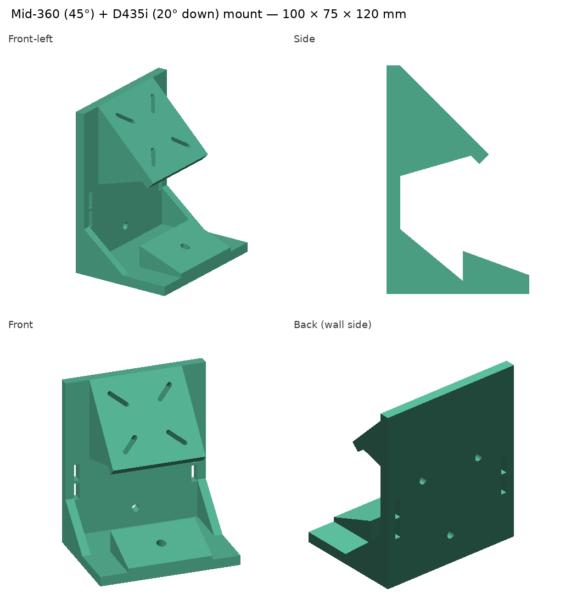
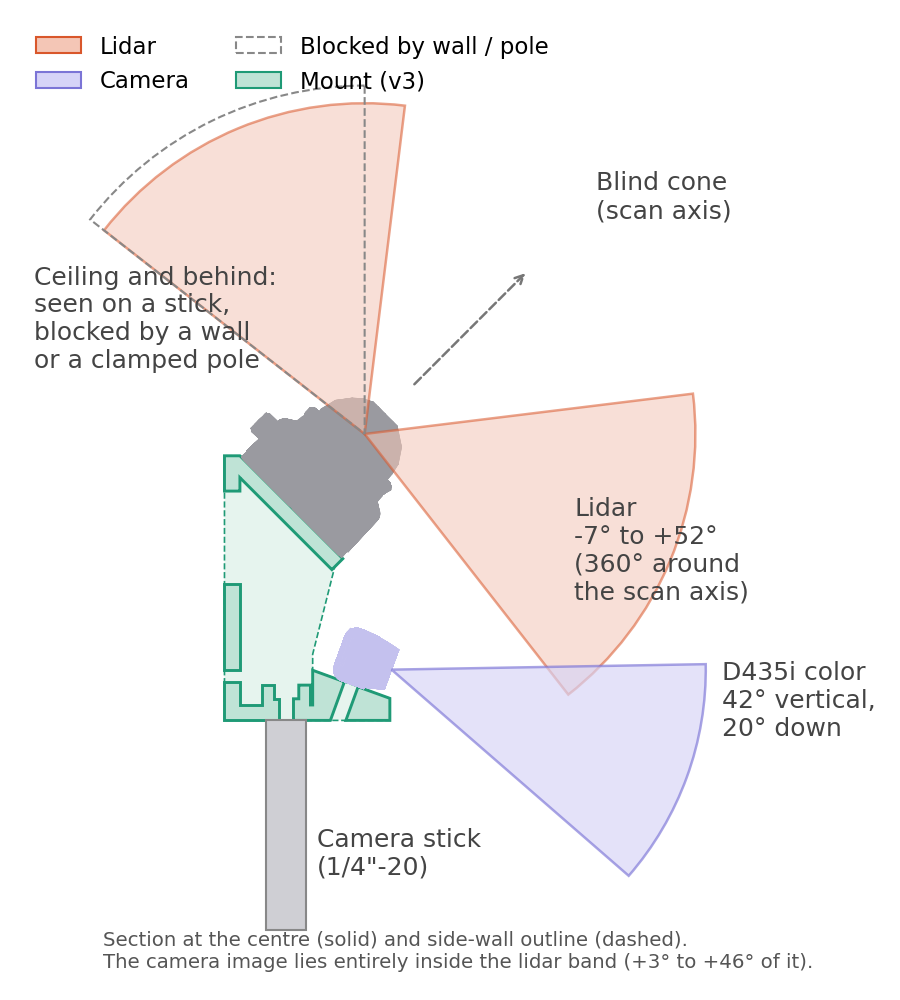

# Mid-360S + D435i mount

A 3D-printable mount for the Livox Mid-360S and an Intel RealSense D435i. The lidar's scan axis is tilted 45° up from horizontal, and the camera is pitched 20° down. It attaches to a camera stick or tripod (1/4"-20), to a pole with hose clamps, or to a wall with M5 screws.

**Lidar plate:** 4× M3 clearance holes on the Mid-360S pattern (48 × 36 mm, centred, 48 mm along the lidar's X axis; user manual v1.0 2026.04, *Dimensions*, and Livox's 3D model) and Ø3 holes for locating pins at ±16 and ±23 mm on the centreline (the round hole and the slot are on opposite sides; both pairs are there, so pins fit either way round). The lidar sits with its connector facing **uphill** (lidar +X downhill), as the design extrinsics assume.

**v3 (current):**
- **Side walls** at both edges, from the back plate to the front of the lidar plate (now 100 mm wide), so the plate is held on three sides. Near the shelf they are cut back to leave room for the camera and its USB-C plug.
- **Back window** under the lidar plate, with a 45° channel to each **uphill** M3 hole: those two screws now go in **from behind** with a 2.5 mm hex key. Fit the lidar before clamping the mount to a pole, since the window faces the pole.
- **Camera-stick socket** on the bottom: drop a 1/4"-20 hex nut (7/16" across flats) into the pocket from above, then screw the stick, monopod or tripod into it from below. It sits 28 mm from the back, clear of the camera screw.
- Sensor positions are unchanged from v2, so the design extrinsics below are the same.

> **Earlier prints:** v1 (radial slots on the 45° diagonals, made for square hole patterns) does **not** match the Mid-360S holes; the reference rig's lidar is held with double-sided foam tape. v2 has the right holes, but only the two downhill screws can be fitted.

<p align="center">
  
</p>
<p align="center">
  
</p>

The sensors in the views are rendered from Livox's published Mid-360S 3D model and the RealSense ROS description's D435 mesh, placed where the mount puts them; the CAD script's clearance checks use simple boxes, so it needs neither file.

**Field of view:** the camera's whole image lies inside the lidar's band (the lidar sees −7° to +52° from its equator; the image spans +3° to +46° of that). The camera covers about 14% of the lidar's field of view, and objects closer than 0.8 m get no lidar points (FAST-LIO's `blind` setting). On a camera stick nothing is behind the mount, so the lidar also sees the ceiling and the area behind you (its upper-back band clears the back plate by ~5 cm); a wall or a hose-clamped pole blocks that part.

| File | What it is |
|------|------------|
| [`mid360_45_d435i_20down_mount_strong.py`](mid360_45_d435i_20down_mount_strong.py) | Parametric CAD source. Edit the parameters at the top and re-run. |
| [`mid360_45_d435i_20down_mount_strong.stl`](mid360_45_d435i_20down_mount_strong.stl) | Printable mesh: watertight, 75 × 100 × 120 mm, 233.4 cm³ |
| [`extrinsics.txt`](extrinsics.txt) | Script output: the design extrinsics computed from the CAD geometry (clearance checks go to the terminal) |
| [`images/`](images/) | CAD views and a field-of-view diagram |

Regenerate from this folder:

```bash
pip install manifold3d trimesh numpy scipy
python3 mid360_45_d435i_20down_mount_strong.py > extrinsics.txt
```

## Design extrinsics

Translations are in metres and quaternions are `(x, y, z, w)`.

### Frames

| Frame | Axes |
|-------|------|
| `livox_frame` (lidar) | X downhill along the plate, Y left, Z along the scan axis |
| `camera_link` (RealSense) | X forward, Y left, Z up; origin at the left IR imager (= depth frame) |
| `camera_*_optical_frame` | Z forward, X right, Y down |

### Camera in lidar frame (`livox_frame` → `camera_link`)

```
t = [0.0842, 0.0175, -0.0669]
q = [0, -0.2164, 0, 0.9763]      # pitch -25°
```

### Lidar in camera frame (`camera_link` → `livox_frame`)

```
t = [-0.0480, -0.0175, 0.0963]
q = [0, 0.2164, 0, 0.9763]
```

### Optical frame in lidar frame (`T_lidar_optical`)

```
[ 0.0000  0.4226  0.9063  0.0842]
[-1.0000  0.0000  0.0000  0.0175]
[ 0.0000 -0.9063  0.4226 -0.0669]
[ 0       0       0       1     ]
```

### Lidar in optical frame (`T_optical_lidar`)

```
[ 0.0000 -1.0000  0.0000  0.0175]
[ 0.4226  0.0000 -0.9063 -0.0963]
[ 0.9063  0.0000  0.4226 -0.0480]
[ 0       0       0       1     ]
```

> **Color vs. depth:** these optical-frame matrices use the origin of `camera_link`, which sits at the **depth / left IR** imager. On the D435i the color sensor is about 15 mm to the left (+Y in `camera_link`), so for projection into the **RGB** image, the X translation of `T_optical_lidar` becomes about `0.0325` instead of `0.0175`. Don't hard-code either matrix. Publish only the static transform below and look up `livox_frame` → `camera_color_optical_frame` through TF. The `realsense2_camera` driver publishes the factory-calibrated `camera_link` → `camera_color_optical_frame` transform.

## ROS 2 static transform

```bash
ros2 run tf2_ros static_transform_publisher \
  --x 0.0842 --y 0.0175 --z -0.0669 \
  --qx 0 --qy -0.2164 --qz 0 --qw 0.9763 \
  --frame-id livox_frame --child-frame-id camera_link
```

## Caveats

- These are **design** values from CAD, not a calibration. Print tolerances and how each sensor seats on the mount will shift them by a few mm and a fraction of a degree. Once everything is printed and mounted, refine them with a target-based or targetless LiDAR–camera calibration.
- The Mid-360S point-cloud origin is **47.0 mm above the sensor's base** (`LIDAR_ORIGIN_H`, from the user manual's drawing). On the reference rig the measured scan-axis tilt is 45.3° and the lidar origin sits **13.0 cm above the mount's bottom edge**, which is what to add to the mount height when entering the lidar height in the UI.
- **Screw access:** the two **downhill** M3 screws go in from below the plate; the two **uphill** ones through the back window (v3). Use M3 × 12 socket-head screws (7 mm plate + 5 mm thread in the lidar).
- **Connector:** it faces uphill; flat against a wall, the M12 plug and its 60 mm cable bend radius need more room than the ~22 mm left, so prefer the stick or pole mount.
- **Calibrated values** for the reference rig are in [`rgb_lidar_fusion/config/mount_extrinsics.yaml`](../../rgb_lidar_fusion/config/mount_extrinsics.yaml) (camera rolled ~0.7° relative to the CAD values above). After printing a new mount, re-run the calibration to check them..
